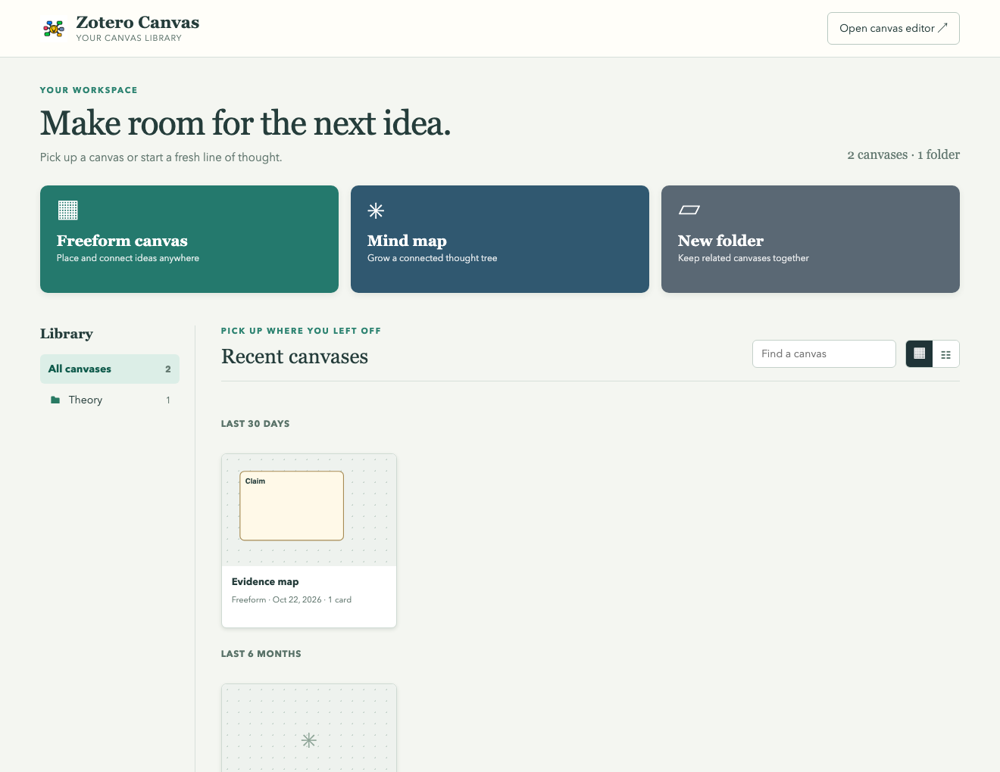
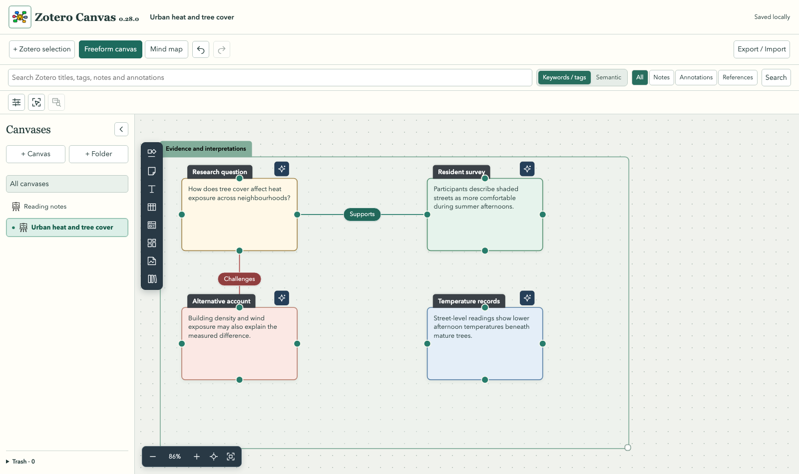
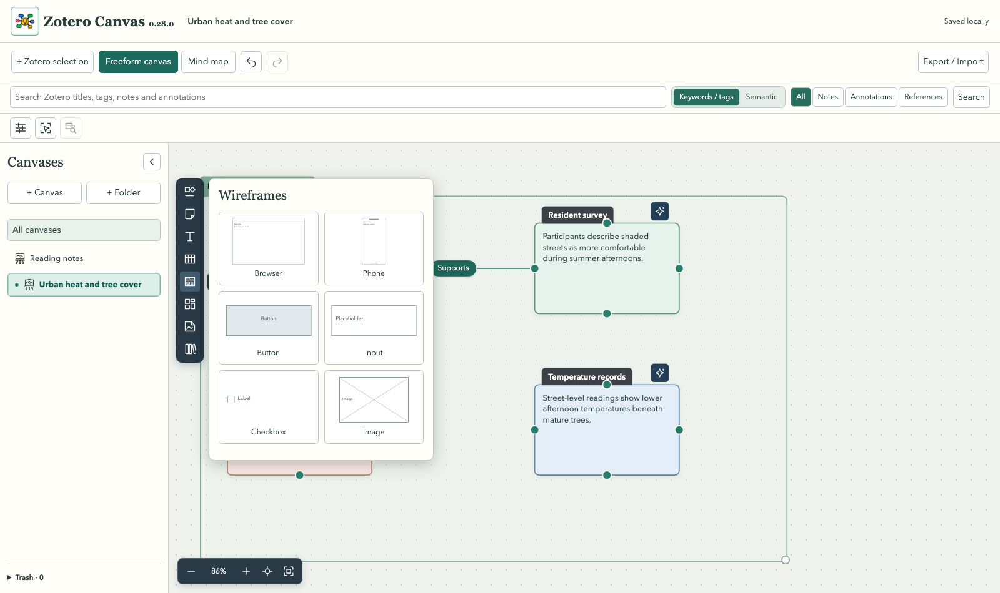

# Zotero Canvas

Zotero Canvas is a Zotero 10 plugin for arranging notes, annotations, references and your own ideas on local canvases. Cards remain linked to their Zotero sources. Create frames, label connectors, compare evidence, and export to SVG, PNG, PDF, JSON or Obsidian Canvas.

## Preview



*Create a freeform canvas, mind map, structured view or folder, then reopen recent work from its preview.*



*A sample evidence map showing cards, a frame, labelled connections and Canvas Explorer.*



*The object toolbar includes shapes, sticky notes, tables, wireframes and more. These screenshots use fictional example content, not a personal Zotero library.*

## Install

1. Download the latest `zotero-canvas-*.xpi` from [Releases](https://github.com/Dcrizz/zotero-research-canvas/releases).
2. In Zotero 10, open **Tools → Plugins**, choose **Install Plugin From File**, and select the XPI.
3. Open the **Zotero Canvas dashboard** from Zotero's right-hand icon rail or Tools menu. Create a freeform canvas, mind map or folder there, or open a recent canvas preview. Your canvases are saved locally in Zotero's data directory under `research-canvas/`.

The tested version is Zotero 10.0.6 on macOS. Other Zotero 10.0 builds and operating systems need community testing. Back up your Zotero profile and canvas directory before upgrading. The plugin does not require an account or AI service for ordinary canvas editing.

## Use the canvas

- Drag Zotero notes, annotations or references onto a canvas, or use the search bar. A card's source action opens the original item; annotation cards can jump to their saved PDF highlight.
- Click the home icon beside **Zotero selection** to save your current canvas and return to the dashboard.
- Open **Templates** on the dashboard, or **Zotero Settings → Zotero Canvas → Manage templates**, to browse templates by format, view card instructions and choose format defaults. Editing **Default Concept Map**, for example, automatically saves card and layout changes under Concept Map; return to the dashboard when finished, without naming it. **Restore built-in defaults** restores all six format designs and default selections while preserving separately named custom templates. Named custom templates open as drafts; **Save template** updates the existing named template.
- Hover near a card edge to show a single attachment ring. Drag from it to create a connector, or drag an existing connector endpoint to any perimeter position. The four fixed connector dots are removed. Positions remain attached as cards move or resize. Corners resize normally; hold **Alt** to resize from an edge. Elbow connectors expose meaningful segment controls with snapping and redundant points removed, so repeated dragging does not keep adding bends.
- AI-authored numbered freeform templates now follow one consistent horizontal or vertical direction, with aligned follow-up branches and facing-side straight or compact elbow connections. Manually specified attachment sides and routes remain available.
- In Zotero’s item and collection explorer, **Canvas tools** groups the Canvas commands under the app icon. **Compare on Canvas**, **Create Concept Map** and **Explain Concept** have distinct icons. **Use custom template…** asks you to choose a saved custom template and an optional focus, then fills a new canvas from the selected sources (or collection contents, up to eight sources).
- In the Templates manager, **Create Template** opens a freeform draft with a guidance card and editable numbered/conditional worked examples covering numbered stages, `Only if:` conditions and evidence rules. Guidance is excluded from saved templates and AI filling. Custom templates require a name. The template selector appears only in the custom library; **Restore default** resets the displayed format, while **Restore all defaults** resets every built-in format.
- The **AI template assistant** icon in the research toolbar offers **Create draft** (describe what you want) and **Revise draft** (improve the open instruction canvas, optionally with a focus). A validated result replaces the open draft as one undoable change. It uses your configured AI provider. These two actions author instructions; **Fill with AI** and **Use custom template** still produce source-grounded findings and analysis. Linked research cards and file objects cannot be sent through the template author.
- Custom templates are separate from assigned format defaults. Create a source-free freeform canvas or mind map with AI instructions in its cards, then use **Save template**. In the dashboard Templates browser, choose **Custom templates (all formats)** to view, edit or delete named templates. Templates belonging to a structured format may also be assigned as that format’s default.
- Right-click blank space to add a card or frame, or to group selected cards and ungroup them later. Drag a grouped card's heading or the group heading to move its members together; ordinary frames remain separate. Use the left object toolbar for shapes, sticky notes, text, tables, wireframes, templates, images, files and [Excalidraw library](https://libraries.excalidraw.com/) imports. Click the active icon again to close its palette.
- Drag a card port onto another card to connect them; click a port to create a smaller child card. Right-click any connector and choose **Add junction** to place a circular node there, then drag that node to a card or another connector. Dropping a card's connector onto a line also creates a junction. Edit route points, arrowheads, colour, thickness and labels from the connector controls.
- Use the format menu to arrange existing cards as a Concept Map, evidence map, comparison matrix, timeline, literature map or process diagram. For a blank comparison matrix, select sources in Zotero's main library pane and click **+ Zotero selection**, or drag them onto the canvas. Generated Concept Maps centre a source-backed definition and spread other cards into four branches; manually arranged Concept Maps centre the first card. Mind maps can run horizontally or vertically; parent-child links attach to facing sides and use direct lines. Drag a card heading to adjust either layout, or choose **Reflow** to restore its automatic position. Switching formats keeps source links and freeform positions.
- The dashboard includes six editable research templates: Concept Map, Evidence Map, Comparison Matrix, Timeline, Literature Map and Process Diagram. The Timeline starter uses a dated horizontal connector spine with circular branch junctions. Each template has native cards and connectors with instructions in the card text. Double-click a card body to edit those instructions; add, move or link cards as needed. Use **Save template** to keep a named copy, optionally set it as the default for that format, and choose it when creating another canvas. The dashboard's creation dialog also lets you select a different template or restore the built-in default.
- To fill an instruction canvas, select 1–8 regular Zotero sources in the main library pane and click **Fill with AI**. An optional focus can steer this run. Each filled card must cite an exact supplied excerpt and retains its Zotero link and page location when available; unsupported optional branches are omitted. A Comparison Matrix repeats its instruction rows for each selected source. The original template remains saved separately; a failed or ungrounded AI response leaves the canvas unchanged. [Concept Map preview](docs/images/concept-template.png) · [Timeline preview](docs/images/timeline-template.png).
- To control fill order, prefix a card title or the first line of its instructions with a number, such as `1. Definition` and `2. Alternative view`. The AI processes numbered steps in ascending order, using verified earlier answers as context. Cards sharing a number run together; unnumbered cards run together afterward. An entirely unnumbered template still runs in one request. Each numbered step makes a separate AI request.
- For a conditional branch, start its instruction text with `Only if: a selected source explicitly describes a competing theory` (a step number may come first). The AI fills that card only when a supplied passage supports the condition. After filling, **Omitted branches** shows the model's reason for each skipped condition; the report is saved with the canvas. Treat this as an assessment of the supplied excerpts, not a finding that the wider library lacks the idea.
- **Evidence health** checks linked cards against their current Zotero sources and flags missing links, changed excerpts and PDF pages that could not be verified. It opens the relevant Zotero item or annotation for review. Page checks use page-positioned text when available; an unavailable page check is marked **Needs review**, never passed as verified.
- **Source coverage** groups cards by parent Zotero work and highlights typed Claim cards with no linked support or only one distinct supporting work. **Argument walkthrough** presents claims, support, challenges and limitations in a guided read-only sequence, retaining the card text, source citation and links back to Zotero.
- Define reusable **Link types** in **Zotero Settings → Zotero Canvas**. Built-ins include green **SL ✅** supporting links and red **❌CL** critical links. Use **Edit** to customise a built-in or custom type's name, displayed label, colour, thickness, pattern, route and arrows; **Reset** restores a customised built-in. Applying a type affects the selected connector; saved connectors retain their current appearance.
- Use the Canvas Explorer to organise canvases in folders, embed one canvas in another, and recover deleted canvases from Trash.
- Select several cards with Shift-click or the drag selection tool to move, resize, align, colour or delete them together. Undo and local version snapshots help recover changes.

Embedded images display in the card. PDFs use a scrollable document viewer; DOCX and plain-text files show scrollable text. Other file types retain the original bytes with a Save file action. Individual files are limited to 20 MB. Exports include embedded assets; Word previews are text extracts, so complex page layout stays in the original file.

## AI and semantic search

AI is optional. **Connections** compares selected cards and proposes links with source excerpts. **Counter** and **Supporting** search notes and annotations for challenging or corroborating evidence; you review each result before adding it. Accepted results connect to the original card. Generation alone never changes the canvas.

In Zotero's items list, right-click 2–8 selected regular sources and choose **Compare selected sources on a canvas** to make a draft literature map of arguments, findings and relationships. Before creation, enter an optional topic, concept or question to focus the comparison; leave it blank for the general map. The map spaces source columns apart and colours generated cards by type: Claim, Finding, Counterargument, Proves, Disproves or Limitation. Links say what they do to the destination card, such as **Supports claim**.

Choose **Create a Concept Map from selected sources** with 1–8 regular sources, then name the concept. The concept sits at the centre; source cards branch to either side. Their titles use an icon and type prefix followed by **Author (YYYY) - Title**. Types include Definition, Theory, Alternative, Justification, Example and Limitation. The topic is the first heading inside each source card. **Explain a concept as a mind map** remains available for a single source and creates a directional mind map.

These actions use saved notes and annotations plus bounded PDF excerpts. When Awesome GPT provides page-positioned PDF text, excerpt cards show that page and open the matching PDF page. Saved PDF annotations keep their Zotero page labels and annotation links. If only Zotero's plain-text PDF index is available, its passages say **page unavailable** and open the PDF without a page jump. Image-only or unindexed PDFs may have no readable passage. Every generated claim quotes a checked passage and links back to its source; connector explanations retain excerpts from both cards. The model sees selected passages, not complete PDFs, so review the draft against the original works before relying on it.

If Awesome GPT is installed and configured, Zotero Canvas uses its model and credentials automatically with the default **Awesome GPT** setting. If the Zotero MCP Plugin's semantic index is enabled and built, Zotero Canvas uses that index automatically for Semantic search, Counter and Supporting. You do not need to enter either integration's credentials again in Zotero Canvas.

Choose one AI provider in **Zotero Settings → Zotero Canvas**:

- **[Awesome GPT](https://github.com/MuiseDestiny/zotero-gpt)** reuses its model and credentials. No key is copied into Zotero Canvas.
- **Own API key** accepts an HTTPS OpenAI-compatible Chat Completions endpoint and model ID. Save the key separately; Zotero's password manager stores it outside canvas files, settings JSON and exports. Provider charges and data handling follow your provider's terms. [OpenAI Chat Completions reference](https://platform.openai.com/docs/api-reference/chat/create).

Semantic search and the Counter/Supporting library workflows additionally need the [Zotero MCP Plugin by cookjohn](https://github.com/cookjohn/zotero-mcp) with its semantic index enabled and built. An own API key replaces Awesome GPT as the text-model provider; it does not replace the semantic index. Zotero Canvas uses that plugin's in-process `callSemanticSearch` service; it does not require an external MCP client or the separate Zotero debugging bridge. Keyword search and AI Connections work without it. See [AI and MCP setup](docs/AI-AND-MCP.md) for steps, limits and troubleshooting.

AI analyses are text-only and bounded. They send the selected card text and, for library searches or source canvases, selected excerpts to the chosen model. Image pixels and image-only annotations are not analysed. You decide whether to accept Connections, Counter and Supporting suggestions; source canvases are saved as editable drafts after exact-quote checks. The semantic service is an internal integration with the Zotero MCP Plugin and may need updating when that plugin changes.

## Optional appearance integrations

Zotero Canvas works without the user's other Zotero plugins. If a [Zotero Style / Ethereal Style](https://github.com/MuiseDestiny/zotero-style) annotation-colour palette is saved, annotation cards use its colour names; otherwise common colours have built-in names and other colours appear as **Custom colour**. The original note content is not changed by this display treatment.

## Data and exports

Canvas files and snapshots stay in your local Zotero data directory. Source notes and annotations retain Zotero's normal saving and sync. JSON export backs up the editable canvas; SVG, PNG and PDF exports are visual snapshots. Obsidian export writes `.canvas`, Markdown and asset files into a folder you choose inside your vault. It is one-way: edits made in Obsidian do not sync back to Zotero. See [Feature guide](docs/FEATURES.md) for more detail.

Linked cards store Zotero library and item keys. A canvas copied to a different Zotero profile can retain its layout, text and embedded assets, but **Open source**, annotation jumps and live note editing only work when that profile can resolve the same Zotero items. The Obsidian export folder is chosen separately on each computer; Send to Obsidian requires an Obsidian vault on that computer.

## Build and test

The installable XPI contains `manifest.json`, `bootstrap.js`, `LICENSE` and `content/`; no Node dependency runs in Zotero. From the repository root:

```sh
npm ci
npm test
npm run test:objects
npm run test:workspace
npm run build
```

`npm run build` writes a deterministic XPI and source archive to the parent directory. Browser tests require Playwright's Chromium (`npx playwright install chromium`). Native Zotero integration tests use a **separate disposable profile** and are described in [Testing](docs/TESTING.md). Do not point the native test runner at your everyday Zotero profile.

## Contributing and licence

Issues and pull requests are welcome. Please include the Zotero version, operating system, steps to reproduce, and whether Awesome GPT or the semantic MCP plugin is installed. Do not include API keys, private notes or Zotero database files in issues. Zotero Canvas is MIT licensed; bundled Excalidraw Forms objects retain their own attribution and MIT notice in [Third-party notices](THIRD_PARTY.md).
